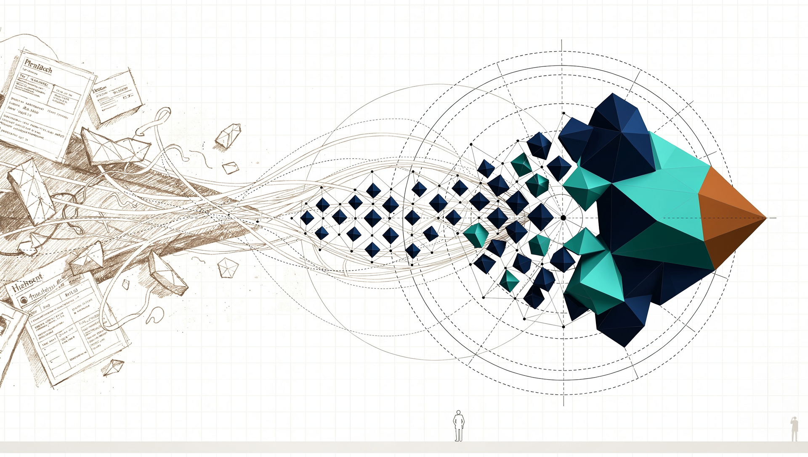

# datacrystal

[](https://github.com/semanticworks-gmbh/datacrystal/actions/workflows/ci.yml) [](CHANGELOG.md) [](.python-version) [](LICENSE)

<p align="center">
  <picture>
    <source srcset="assets/hero.avif" type="image/avif">
    
  </picture>
</p>

datacrystal is an embedded object-graph database for Python developers: define typed dataclasses, mutate them, call `commit()`, and the whole graph stays durable and queryable across restarts, with the same objects, identities and references.

## Status

Status: **0.10.0**, Python 3.14.
The API froze at the v0.1.0 baseline and v0.2–0.10 are purely additive.
It is not on PyPI yet (the name is reserved), so you install from a git tag; changes are in the [CHANGELOG](CHANGELOG.md).

## Quickstart

```bash
uv add "datacrystal @ git+https://github.com/semanticworks-gmbh/datacrystal@v0.10.0"
```

Save this as `cabinet.py` and run `python cabinet.py` twice; the second run finds the data and the counter reads 2.

```python
from typing import Annotated
import datacrystal as dc

@dc.entity
class Locality:
    qid: Annotated[str, dc.Unique]                # unique key, looked up by store.get()
    name: str

@dc.entity
class Mineral:
    qid: Annotated[str, dc.Unique]
    name: str
    crystal_system: Annotated[str | None, dc.Index] = None   # bitmap index, answers store.query()
    type_locality: dc.Lazy[Locality] | None = None            # loads on first .get()

store = dc.Store.open("cabinet.store")
if store.root is None:                            # first run only
    tsumeb = Locality(qid="Q571997", name="Tsumeb Mine")
    store.root = {"runs": 0, "minerals": [
        Mineral(qid="Q43010", name="quartz", crystal_system="trigonal"),
        Mineral(qid="Q193563", name="azurite", crystal_system="monoclinic",
                type_locality=dc.Lazy.of(tsumeb)),
    ]}
store.root["runs"] += 1                           # in-place mutation is tracked
store.commit()                                    # one atomic transaction

hits = store.query(Mineral.crystal_system == "monoclinic")
print(sorted(m.name for m in hits))               # ['azurite']
print(store.root["runs"])                         # 1, then 2
store.close()
```

## Usage

- Mutate entities and call `commit()`; there is no session, no `save()` and no schema file, because schema, indexes and search config live in the type through `Annotated[...]`.
- `store.query(...)` answers `==`, `.in_()`, ranges (`dc.SortedIndex`), `order_by`, `limit` and `offset` through a rule-based planner, and `store.explain(...)` shows the plan.
- `count()` and `pluck()` read fields without building entities, and `store.incoming(entity)` finds the entities that reference one.
- `dc.Lazy[T]` is the explicit memory cut point: following an edge hydrates only the nodes on the path, and entities you drop are garbage-collected.
- Every commit is atomic, durability is a policy you pick (`commit`, `interval`, `never`), and a `kill -9` test gates this in CI.
- One writer and many readers: `store.snapshot()` gives any thread a frozen read view, and `aopen` is the async store.
- `store.migrate()`, `dc.RenamedFrom` and `dc.Glue` evolve a schema; `dc.Blob` keeps large binaries out of records; `@entity(protected=True)` adds read and write floors.
- `Store.follower(url)` opens a real local replica that reads at full speed and contributes writes back to a single-writer coordinator.
- Records are msgspec msgpack and decoding cannot execute code.
- Not yet: the `datacrystal[vector]` approximate index, an S3 object-store backend and cross-mirror join recipes ([roadmap](docs/design/ROADMAP.md)).

## Extras

- `datacrystal[fts]`: FTS5 full-text search with per-language Snowball stemming and BM25 over `dc.FullText` fields.
- `datacrystal[arrow]`: persistent Parquet mirrors that give DuckDB, polars and pandas zero-copy Arrow tables.
- `datacrystal[web]`: reflect `@entity` into FastAPI and Pydantic REST and Strawberry GraphQL routes, with the federation coordinator.
- `datacrystal[follower]`: the HTTP client for `Store.follower`.

## Development gates

```bash
uv sync --all-extras
uvx ruff check . && uv run pyrefly check
uv run pytest -q
uv run python examples/minerals/demo.py   # run it twice, the data survives
```

[CONTRIBUTING.md](CONTRIBUTING.md) has the house rules, and [STANDARDS.md](STANDARDS.md) the rules a diff is checked against.

## Docs

- [docs/GUIDE.md](docs/GUIDE.md) indexes the [tutorial](docs/tutorial.md), the [how-to guides](docs/how-to/), the [reference](docs/reference.md) and the [explanation](docs/explanation.md).
- [docs/design/](docs/design/) holds the vision, the architecture, the ADRs and the [roadmap](docs/design/ROADMAP.md).
- [docs/research/](docs/research/) holds the per-topic evidence.
- License: [MIT](LICENSE).
